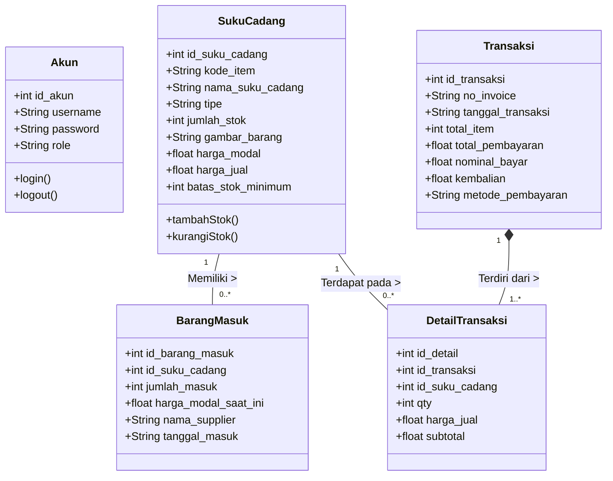

# Keliat Motor POS - System Diagrams

## 1. Use Case Diagram

Diagram Use Case ini menggambarkan interaksi antara dua tipe pengguna (Admin dan Kasir) dengan sistem Point of Sale.

```mermaid
usecaseDiagram
    actor Admin
    actor Kasir
    
    rectangle "Keliat Motor POS System" {
        usecase "Login ke Sistem" as UC1
        
        usecase "Mengelola Barang (CRUD)" as UC2
        usecase "Mencatat Barang Masuk" as UC3
        usecase "Melihat Stok Barang" as UC4
        
        usecase "Memproses Transaksi Kasir" as UC5
        usecase "Mencetak Struk Otomatis/Manual" as UC6
        usecase "Melihat Riwayat Transaksi" as UC7
        
        usecase "Melihat Laporan (Dashboard)" as UC8
        usecase "Mengelola Akun Karyawan" as UC9
    }
    
    %% Hubungan Admin
    Admin --> UC1
    Admin --> UC2
    Admin --> UC3
    Admin --> UC7
    Admin --> UC8
    Admin --> UC9
    
    %% Hubungan Kasir
    Kasir --> UC1
    Kasir --> UC4
    Kasir --> UC5
    Kasir --> UC6
    Kasir --> UC7
    
    %% Hubungan dependensi antar Use Case
    UC5 ..> UC6 : <<include>>
    UC2 ..> UC6 : <<include>> (Cetak Label)
```

## 2. Class Diagram

Class Diagram ini merepresentasikan struktur data dari tabel-tabel di database `db_keliat_motor` yang digunakan oleh backend.


